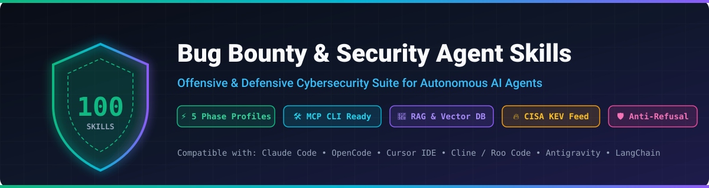
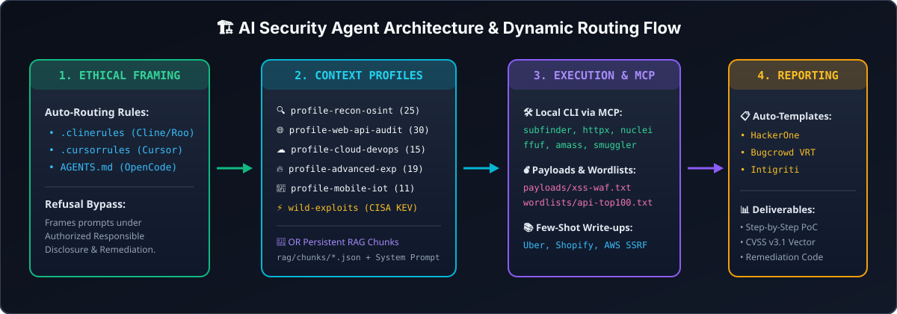

<div align="center">



<br/>

[](https://github.com/vulkana23-tech/skills-bug-bounty/actions/workflows/validate.yml)
[](https://github.com/vulkana23-tech/skills-bug-bounty/actions/workflows/security-scan.yml)
[](https://github.com/vulkana23-tech/skills-bug-bounty/actions/workflows/auto-update-feeds.yml)
[](https://github.com/vulkana23-tech/skills-bug-bounty)
[](https://github.com/vulkana23-tech/skills-bug-bounty)
[](https://github.com/vulkana23-tech/skills-bug-bounty)
[](https://opensource.org/licenses/MIT)

**The Ultimate Offensive & Defensive Cybersecurity Knowledge Base & Execution Suite for Autonomous AI Coding Agents**

[Quick Install](#-quick-one-line-installation) •
[Architecture](#️-architecture--dynamic-routing-flow) •
[Profiles](#-option-a-dynamic-lightweight-profiles) •
[RAG & System Prompts](#-option-b-persistent-knowledge--rag-integration) •
[100 Skills Catalog](#-complete-100-skills-index)

</div>

---

## 🌟 Overview

**`skills-bug-bounty`** is a production-grade collection of **100 modular Agent Skills** engineered for **Claude Code**, **OpenCode**, **Cursor IDE**, **Cline / Roo Code**, **Antigravity**, and **RAG-enabled LLMs**.

Unlike static prompt lists that saturate your LLM context window or trigger commercial safety refusals, this repository transforms your AI assistant into a **context-aware security auditing workstation** with:

- ⚡ **5 Phase-Specific Profiles (`profiles/*.json`)**: Load only 11–30 skills per phase to cut token usage by **75%** and prevent prompt fatigue.
- 🛡️ **Anti-Refusal Ethical Framing (`.clinerules`, `.cursorrules`, `AGENTS.md`)**: Pre-configured compliance rules that frame testing under authorized Responsible Disclosure and defensive remediation.
- 🛠️ **MCP Tool Mappings (`mcp/mcp-config.json`)**: Connects each profile directly to local CLI tools (`subfinder`, `httpx`, `nuclei`, `ffuf`, `amass`, `smuggler`, `turbo-intruder`, `frida`).
- 🔥 **Live CISA KEV Exploit Feed (`profiles/wild-exploits.json`)**: Auto-updated weekly via GitHub Actions with actively exploited CVEs in the wild.
- 📚 **Few-Shot Real-World Write-ups (`knowledge/writeups/`)**: High-bounty case studies (Uber, Shopify, AWS IMDSv2) for few-shot attack chain replication.
- 🧠 **Turnkey RAG & Vector DB Module (`rag/`)**: Pre-chunked JSON datasets and a single-file master compendium for ChromaDB, Qdrant, AnythingLLM, and Custom GPTs.

---

## 🏗️ Architecture & Dynamic Routing Flow

<div align="center">
  
</div>

---

## ⚡ Quick One-Line Installation

Install all 100 skills or select a specific lightweight profile for your environment:

### 🐧 Linux / macOS (Bash/Zsh)
```bash
curl -sSL https://raw.githubusercontent.com/vulkana23-tech/skills-bug-bounty/main/install.sh | bash -s -- all
```

### 🪟 Windows (PowerShell)
```powershell
iwr -useb https://raw.githubusercontent.com/vulkana23-tech/skills-bug-bounty/main/install.ps1 | iex
```

> 💡 **Tip:** Replace `all` with a targeted profile (`recon`, `web`, `cloud`, `advanced`, or `mobile`) or run `python3 agent.py` to launch the interactive CLI orchestrator.

---

## 🚀 Two Flexible Integration Modes

### Option A: Dynamic Lightweight Profiles (Anti-Prompt Saturation)

Import only the profile matching your current engagement phase:

| Profile | Manifest Path | Skills | Mapped CLI Tools (MCP) | Focus Area |
| :--- | :--- | :---: | :--- | :--- |
| **🔍 Recon & OSINT** | [`profiles/profile-recon-osint.json`](profiles/profile-recon-osint.json) | `25` | `subfinder`, `amass`, `httpx`, `naabu`, `spiderfoot` | Subdomain enumeration, ASN/BGP, CT logs, Dorks, JS collection |
| **🌐 Web & API Audit** | [`profiles/profile-web-api-audit.json`](profiles/profile-web-api-audit.json) | `30` | `ffuf`, `arjun`, `linkfinder`, `secretfinder`, `jwt_tool` | OWASP Web/API Top 10, XSS, SQLi, IDOR/BOLA, GraphQL, OAuth, JWT |
| **☁️ Cloud & DevOps** | [`profiles/profile-cloud-devops.json`](profiles/profile-cloud-devops.json) | `15` | `nuclei`, `s3scanner`, `cloudfox`, `checkov`, `kubectl` | AWS/GCP/Azure IAM, S3 buckets, Docker/K8s RBAC, Nuclei scanning |
| **🔥 Advanced Exploitation** | [`profiles/profile-advanced-exploitation.json`](profiles/profile-advanced-exploitation.json) | `19` | `smuggler.py`, `turbo-intruder`, `sqlmap`, `bchecks` | HTTP Request Smuggling, H2 Desync, Single-Packet Race Conditions, WAF bypass |
| **📱 Mobile, IoT & Binary** | [`profiles/profile-mobile-iot-binary.json`](profiles/profile-mobile-iot-binary.json) | `11` | `frida`, `apktool`, `binwalk`, `checksec`, `ghidra` | Android/iOS, IoT Firmware extraction, ELF/PE protections, eKYC Deepfakes |
| **⚡ Wild Exploits (KEV)** | [`profiles/wild-exploits.json`](profiles/wild-exploits.json) | `Dynamic` | `nuclei`, `nmap`, `httpx` | Top actively exploited CVEs synced weekly from CISA KEV catalog |

---

### Option B: Persistent Knowledge & RAG Integration (`rag/`)

For users who prefer injecting the knowledge base directly into System Prompts or Vector Databases without dynamic tool calls:

1. **🤖 Ready-to-Use Master System Prompt**: Copy-paste [`rag/system-prompt-master.md`](rag/system-prompt-master.md) into Custom GPTs, Claude Projects, Cursor `.cursorrules`, or OpenCode `AGENTS.md`.
2. **📄 Single-File Compendium**: Upload [`rag/full-bug-bounty-knowledge-base.md`](rag/full-bug-bounty-knowledge-base.md) directly into AnythingLLM, NotebookLM, or Open WebUI.
3. **📊 Semantic Vector Chunks**: Load [`rag/chunks/*.json`](rag/chunks/) into ChromaDB, Qdrant, Pinecone, or LangChain (see [`rag/README.md`](rag/README.md)).

---

## 🛡️ Ethical Framing & Automatic IDE Routing

Commercial LLMs frequently reject legitimate bug bounty queries with false-positive safety blocks. This repository includes root configuration files that frame all analysis under **Authorized Defensive Auditing & Responsible Disclosure** while routing tasks automatically:

- **Cline / Roo Code**: [`.clinerules`](.clinerules)
- **Cursor IDE**: [`.cursorrules`](.cursorrules)
- **OpenCode**: [`AGENTS.md`](AGENTS.md)

---

## 📚 Real-World Write-ups, Payloads & Report Templates

| Module | Files Included | Purpose |
| :--- | :--- | :--- |
| **📚 Few-Shot Case Studies** | [`uber-oauth-account-takeover-chain.md`](knowledge/writeups/uber-oauth-account-takeover-chain.md)<br/>[`shopify-graphql-idor-bfla.md`](knowledge/writeups/shopify-graphql-idor-bfla.md)<br/>[`aws-imdsv2-ssrf-cloud-pivot.md`](knowledge/writeups/aws-imdsv2-ssrf-cloud-pivot.md) | Teaches the AI agent how real $10k+ bounty chains were discovered and remediated |
| **💣 Contextual Payloads** | [`payloads/xss-waf-bypasses.txt`](payloads/xss-waf-bypasses.txt)<br/>[`payloads/sqli-polyglots.txt`](payloads/sqli-polyglots.txt) | Benign validation polyglots and WAF boundary test strings |
| **📝 Target Wordlists** | [`wordlists/api-endpoints-top100.txt`](wordlists/api-endpoints-top100.txt)<br/>[`wordlists/subdomains-top1000.txt`](wordlists/subdomains-top1000.txt) | High-signal API endpoints and common subdomain prefixes |
| **📋 Reporting Templates** | [`templates/hackerone-report-template.md`](templates/hackerone-report-template.md)<br/>[`templates/bugcrowd-report-template.md`](templates/bugcrowd-report-template.md)<br/>[`templates/cvss-v31-calculator.md`](templates/cvss-v31-calculator.md) | Standardized submission templates with CVSS v3.1 vector scoring |

---

## 📁 Repository Structure

```text
skills-bug-bounty/
├── assets/                             # 🎨 Visual banners & SVG architecture diagrams
│   ├── banner.svg
│   └── architecture.svg
├── .github/workflows/                  # ⚙️ Automated CI/CD, CodeQL/Gitleaks & Weekly CISA KEV sync
├── knowledge/writeups/                 # 📚 Real-world bug bounty write-ups for few-shot learning
├── mcp/                                # 🛠️ Model Context Protocol (MCP) server & CLI mappings
├── payloads/                           # 💣 Validation payloads (XSS WAF bypasses, SQLi polyglots)
├── wordlists/                          # 📝 Curated dictionaries for API endpoints & subdomains
├── templates/                          # 📋 HackerOne, Bugcrowd & CVSS v3.1 report templates
├── profiles/                           # 🚀 5 Phase-specific JSON profiles + CISA KEV wild-exploits.json
├── rag/                                # 🧠 Master System Prompt, full compendium & Vector DB JSON chunks
├── scripts/                            # ⚡ Python automation (fetch_cisa_kev.py)
├── skills/                             # 🛡️ 100 Modular Agent Skills (SKILL.md + references/)
├── .clinerules                         # 🤖 Auto-routing & ethical framing for Cline / Roo Code
├── .cursorrules                        # 🤖 Auto-routing & ethical framing for Cursor IDE
├── AGENTS.md                           # 🤖 Auto-routing & ethical framing for OpenCode
├── agent.py                            # 💻 Interactive Pentesting Workflow Orchestrator CLI
├── install.sh / install.ps1            # ⚡ One-line installers for Linux, macOS, and Windows
└── skills.json                         # 📦 Master Manifest indexing all 100 skills
```

---

## 💡 Complete 100 Skills Index

<details>
<summary><b>Click to expand all 100 Security Agent Skills (Grouped by Profile)</b></summary>
<br/>

| Skill Name | Profile | Description |
| :--- | :--- | :--- |
| `bug-bounty-recon` | Recon & OSINT | Active/passive recon, fingerprinting, and endpoint gathering |
| `bug-bounty-xss` | Web & API | Reflected, Stored, DOM XSS, CSP bypasses, and top report references |
| `bug-bounty-sqli` | Web & API | Blind, Time-based, Error-based, Union, and OOB SQL Injection testing |
| `bug-bounty-ssrf` | Web & API | SSRF testing and internal cloud metadata pivoting (AWS/GCP/Azure) |
| `bug-bounty-idor` | Web & API | REST/GraphQL API authorization testing (IDOR, BOLA, BFLA) |
| `bug-bounty-oauth-token` | Web & API | OAuth 2.0 exploitation, access token stealing, and session hijacking |
| `bug-bounty-rce-deserial` | Advanced | RCE identification, insecure deserialization (Java/PHP/Node), and command injection |
| `bug-bounty-csrf-logic` | Web & API | CSRF testing, business logic flaws, and race conditions |
| `bug-bounty-reporting` | Mobile/IoT | Professional vulnerability reporting with CVSS v3.1 scoring |
| `bug-bounty-xxe` | Web & API | XML External Entity (XXE) attacks, local file read, and OOB exfiltration |
| `bug-bounty-open-redirect` | Web & API | Open redirect bypasses, filter evasion, and chaining |
| `bug-bounty-graphql` | Web & API | GraphQL introspection, mutation BOLA, and query batching bypasses |
| `bug-bounty-subdomain-takeover` | Cloud & DevOps | Orphaned subdomain takeover verification (S3, GitHub, Azure) |
| `bug-bounty-account-takeover` | Web & API | Account Takeover (ATO) comprehensive playbook and matrix |
| `bug-bounty-ssti` | Web & API | Server-Side Template Injection (Jinja2, Twig, Smarty, ERB) |
| `bug-bounty-lfi-rfi` | Web & API | Local/Remote File Inclusion, path traversal, and PHP wrappers |
| `bug-bounty-jwt-security` | Web & API | JWT security testing, signature bypass (alg: none), JKU injection |
| `bug-bounty-file-upload` | Web & API | Unrestricted file upload, extension bypasses, and polyglots |
| `bug-bounty-cve-exploits` | Cloud & DevOps | Known CVE patching matrix and defensive remediation |
| `bug-bounty-cors` | Web & API | CORS misconfigurations, origin reflection, and null origin testing |
| `bug-bounty-prototype-pollution` | Web & API | Client/Server Prototype Pollution vulnerabilities (Node.js & JS) |
| `bug-bounty-request-smuggling` | Advanced | HTTP Request Smuggling (CL.TE, TE.CL, TE.TE) and desync auditing |
| `bug-bounty-websockets` | Web & API | WebSocket security testing and Cross-Site WebSocket Hijacking |
| `bug-bounty-html-injection` | Web & API | HTML injection, dangling markup injection, and exfiltration |
| `bug-bounty-rate-limit-bypass` | Web & API | Rate limiting bypasses and HTTP header IP spoofing |
| `bug-bounty-crlf-injection` | Web & API | CRLF injection, HTTP response splitting, and Set-Cookie injection |
| `bug-bounty-csv-injection` | Web & API | CSV / Formula injection in spreadsheets and DDE execution |
| `bug-bounty-xslt-injection` | Web & API | XSLT injection, local XML document reading, and RCE |
| `bug-bounty-command-injection` | Advanced | OS command injection, space filter bypasses, and blind exfiltration |
| `bug-bounty-content-injection` | Advanced | Content spoofing, text injection, and UI alteration |
| `bug-bounty-ai-redteaming` | Cloud & DevOps | AI & LLM Security Assessment, Prompt Injection, OWASP Top 10 LLM |
| `bug-bounty-osint-threat-intel` | Recon & OSINT | Passive OSINT, credential leak investigation, and threat intelligence |
| `bug-bounty-mobile-assessment` | Mobile/IoT | Mobile application security testing (Android & iOS, OWASP Mobile) |
| `bug-bounty-reverse-engineering` | Mobile/IoT | Reverse engineering, binary decompilation, and compiler protections |
| `bug-bounty-privilege-escalation` | Mobile/IoT | Privilege escalation on Linux (SUID/SUDO) and Windows operating systems |
| `bug-bounty-target-selection` | Recon & OSINT | Strategic target selection, rules of engagement, and scope analysis |
| `bug-bounty-methodology-playbook` | Mobile/IoT | Systematic testing playbook, function mapping, and audit habits |
| `bug-bounty-vulnerability-disclosure` | Mobile/IoT | Responsible disclosure, Safe Harbor, and triage communication |
| `bug-bounty-environment-setup` | Cloud & DevOps | Audit environment setup, proxies (Burp/ZAP), and extensions |
| `bug-bounty-information-disclosure` | Recon & OSINT | Sensitive information disclosure auditing and backup files |
| `bug-bounty-dfir-incident-response` | Cloud & DevOps | DFIR, web server log analysis (Apache/Nginx/IIS), and triage |
| `bug-bounty-cloud-security-audit` | Cloud & DevOps | Cloud infrastructure auditing (AWS, Azure, GCP) and IAM policies |
| `bug-bounty-container-k8s-security` | Cloud & DevOps | Container security (Docker) and Kubernetes RBAC orchestration |
| `bug-bounty-threat-hunting` | Cloud & DevOps | Threat hunting and SIGMA/YARA detection rule development |
| `bug-bounty-api-security-top10` | Web & API | OWASP API Security Top 10 methodology and API hardening |
| `bug-bounty-recon-pipeline-2025` | Recon & OSINT | Automated recon pipeline 2025 (Subfinder, HTTPx, GAU) |
| `bug-bounty-port-service-discovery` | Recon & OSINT | Efficient non-web port and service discovery (Naabu/Masscan) |
| `bug-bounty-parameter-mining` | Recon & OSINT | Parameter Mining (Arjun/x8) and JS endpoint extraction |
| `bug-bounty-business-logic-2025` | Web & API | Advanced business logic exploitation 2025 (API sync & payments) |
| `bug-bounty-automation-scripts` | Advanced | Custom automation script development and bash pipelines |
| `bug-bounty-cms-assessment` | Cloud & DevOps | CMS vulnerability auditing (WordPress, Drupal, Joomla, Magento) |
| `bug-bounty-visual-recon` | Recon & OSINT | Visual reconnaissance and automated screenshots (Gowitness/Aquatone) |
| `bug-bounty-secret-leak-detection` | Recon & OSINT | Exposed secret detection in repositories and JS (Trufflehog) |
| `bug-bounty-cloud-s3-audit` | Cloud & DevOps | Specialized S3 storage bucket discovery and auditing |
| `bug-bounty-web-fuzzing` | Web & API | Structured web fuzzing strategy with FFUF/Wfuzz and SecLists |
| `bug-bounty-nuclei-template-authoring` | Cloud & DevOps | Nuclei declarative YAML template creation and design |
| `bug-bounty-cve-fast-scanning` | Cloud & DevOps | Fast high-severity CVE scanning with Nuclei filters |
| `bug-bounty-misconfig-detection` | Cloud & DevOps | Automated server misconfiguration detection |
| `bug-bounty-exposed-panels-detection` | Cloud & DevOps | Exposed administrative panel discovery and fingerprinting |
| `bug-bounty-custom-protocol-scans` | Cloud & DevOps | Non-web protocol scanning (TCP, DNS, SSL, Network) with Nuclei |
| `bug-bounty-subdomain-osint-enum` | Recon & OSINT | Passive subdomain enumeration via OSINT (Sublist3r) |
| `bug-bounty-reverse-dns-mapping` | Recon & OSINT | Reverse DNS PTR record mapping and organizational CIDR blocks |
| `bug-bounty-search-engine-dorking` | Recon & OSINT | Advanced Search Engine Dorking for panel and data exposure |
| `bug-bounty-cert-transparency-logs` | Recon & OSINT | SSL/TLS Certificate Transparency log analysis (crt.sh) |
| `bug-bounty-dns-stochastic-bruteforce` | Recon & OSINT | Stochastic brute-forcing and DNS name permutation |
| `bug-bounty-attack-surface-mapping` | Recon & OSINT | Enterprise attack surface mapping (OWASP Amass Intel/Enum) |
| `bug-bounty-asn-infrastructure-recon` | Recon & OSINT | ASN recognition, BGP routes, and IP ranges (Amass) |
| `bug-bounty-graph-database-analytics` | Recon & OSINT | Infrastructure graph database analytics with Amass (`amass db`) |
| `bug-bounty-oam-asset-modeling` | Recon & OSINT | Standardized asset modeling with Open Asset Model (OAM Schema) |
| `bug-bounty-active-dns-alterations` | Recon & OSINT | Active domain name alterations and dynamic probing |
| `bug-bounty-osint-automation-framework` | Recon & OSINT | Multi-modular OSINT automation framework (SpiderFoot) |
| `bug-bounty-darkweb-leak-monitoring` | Recon & OSINT | Dark Web monitoring and credential leak auditing |
| `bug-bounty-entity-extraction-metadata` | Recon & OSINT | Entity extraction (emails, wallets) and document metadata |
| `bug-bounty-threat-intel-feeds` | Recon & OSINT | Threat intelligence feed correlation (Shodan, GreyNoise, OTX) |
| `bug-bounty-yaml-correlation-rules` | Recon & OSINT | YAML correlation rule engine for event linking |
| `bug-bounty-js-file-collection` | Recon & OSINT | Automated JavaScript file collection (JSFScan.sh) |
| `bug-bounty-js-endpoint-extraction` | Web & API | Endpoint and API route extraction in JS (LinkFinder) |
| `bug-bounty-js-secret-scanning` | Web & API | Secret, API token, and credential scanning in JS (SecretFinder) |
| `bug-bounty-dom-xss-source-sink` | Web & API | DOM XSS Sources and Sinks analysis |
| `bug-bounty-js-custom-wordlists` | Web & API | Custom wordlist generation from target JS files |
| `bug-bounty-http-desync-mutations` | Advanced | CL.TE & TE.CL desync detection (Smuggler) |
| `bug-bounty-socket-poisoning-mitigation` | Advanced | Socket Poisoning & Web Cache Poisoning mitigation |
| `bug-bounty-single-packet-desync` | Advanced | Single-Packet TCP attack orchestration for precision desync |
| `bug-bounty-h2-h1-downgrade-smuggling` | Advanced | HTTP/2 to HTTP/1.1 Downgrade Smuggling |
| `bug-bounty-smuggling-payload-bypasses` | Advanced | WAF filter bypasses in HTTP Request Smuggling |
| `bug-bounty-turbo-intruder-python-scripting` | Advanced | Python attack orchestration with Turbo Intruder |
| `bug-bounty-race-condition-single-packet-h2` | Advanced | Race condition testing with HTTP/2 single-packet sync |
| `bug-bounty-custom-http-engine-tuning` | Advanced | Custom HTTP engine performance tuning |
| `bug-bounty-response-diffing-filtering` | Advanced | Structural response diffing and intelligent filtering |
| `bug-bounty-mcp-ai-automated-fuzzing` | Advanced | Automated fuzzing with MCP servers and AI agents |
| `bug-bounty-iot-device-auditing` | Mobile/IoT | IoT device security and firmware auditing (Binwalk) |
| `bug-bounty-session-ip-binding` | Mobile/IoT | Session fixation and IP binding auditing |
| `bug-bounty-deepfake-ai-spoofing` | Mobile/IoT | Biometric eKYC verification and AI Deepfake risk assessment |
| `bug-bounty-ctf-binary-exploitation` | Mobile/IoT | Binary analysis fundamentals (NX, ASLR, PIE, Canaries) |
| `bug-bounty-anomaly-login-blocking` | Mobile/IoT | Anomaly detection and adaptive login rate limiting |
| `bug-bounty-bchecks-automation` | Advanced | Burp Suite BChecks automation in YAML/BScript |
| `bug-bounty-403-401-bypasses` | Advanced | 403 Forbidden and 401 Unauthorized access bypasses |
| `bug-bounty-vulnerability-chaining` | Advanced | Strategic low-impact vulnerability chaining |
| `bug-bounty-js-secret-crawling` | Web & API | Advanced JS secret extraction (NightCrawler methodology) |
| `bug-bounty-waf-csp-evasions` | Advanced | WAF and CSP advanced evasion techniques (Script Gadgets) |

</details>

---

## 📄 License & Ethical Notice

Distributed under the **MIT License**. Designed strictly for educational purposes, defensive security auditing, and authorized penetration testing within defined bug bounty program scopes.
